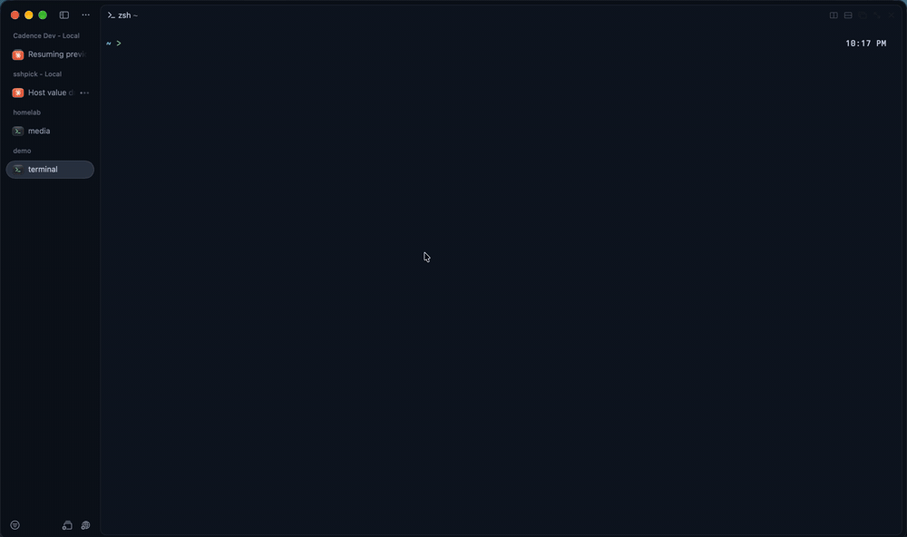
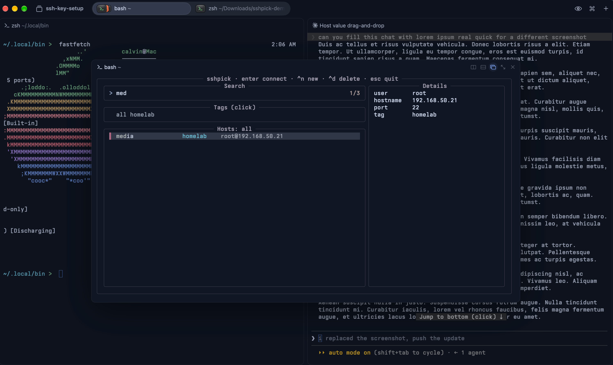

# sshpick

A floating SSH host picker for [Rex](https://www.superlogical.com/rex). Press a key, pick a host from your `~/.ssh/config`, and land in a tab named after it, grouped into a Rex session by tag. It also works as a plain picker in any terminal.



## Why this exists

This is a small personal project. I wanted fast SSH access from Rex while its Linux server is still in beta.

For your own Linux machines, Rex's remote hosts will be the better option: run the Rex server on the machine, and the Mac app connects to it directly. Sessions live on that machine and survive disconnects, and splits, tabs, and the `rex` CLI all work there. Once that's generally available and supports SSH keys (planned), use it wherever you can.

sshpick covers the rest: machines that won't run a Rex server, such as appliances like a NAS or Home Assistant, short-lived cloud VMs, and servers you don't control. For those, a plain `ssh` tab is still the right tool, and sshpick makes getting to one faster.

## Features

**Finding hosts**

- **Uses your existing SSH config.** Hosts come from `~/.ssh/config` and any files it pulls in with `Include`. There's no separate host database.
- **Fuzzy search** across names, tags, users, and addresses, with a details pane for the highlighted host.
- **Favorites.** Star a host with `ctrl-f` and it stays at the top.
- **Recent first.** Hosts are sorted by when you last connected. Press `ctrl-o` to switch to A–Z; sshpick remembers your choice.
- **Tags.** Add a `Tag` to a host to group it. Press `tab` and `shift-tab` (or click a tag) to filter the list.

**Connecting in Rex**

- **Opens as a floating popup** over whatever you're working on, and closes when you connect.
- **One session per tag, one tab per host.** Connecting to a `homelab` host opens a tab named after it in your `homelab` session, creating the session if needed. Untagged hosts go to a session named `ssh`.
- **Jumps to open tabs.** If a host already has a tab, Enter switches to it instead of opening a duplicate. `alt-enter` opens another tab anyway. The details pane shows when a host is open or disconnected.
- **Reconnects.** If a connection drops, the tab stays open with "r reconnect · any other key closes". Logging out normally just closes the tab.

**Managing hosts**

- **Add** a host with `ctrl-n`: a step-by-step form for the alias, hostname, user, port, tag, and key. sshpick writes it to your config, checks that the port is open and that key login works, and offers to run `ssh-copy-id` if it doesn't.
- **Edit** a host with `ctrl-e`. This works for hosts sshpick added, which it marks with an `# added by sshpick` comment. Hosts you wrote yourself are left alone.
- **Delete** a host with `ctrl-d`. Your config is backed up to `~/.ssh/config.bak` first. Hosts from `Include`d files have to be removed in their own file, and sshpick tells you which one.

**Without Rex**

- Outside Rex, or with `sshpick --inline`, sshpick opens below your prompt and runs `ssh` in the same terminal. Everything under "Finding hosts" and "Managing hosts" works the same way. It only needs fzf.

## Requirements

- **macOS**
- **fzf 0.65 or newer**: `brew install fzf`
- **OpenSSH 9.4 or newer**, for the `Tag` keyword. Recent macOS already has it; check with `ssh -V`.
- For the Rex features: **Rex**, and **jq** (preinstalled on recent macOS, or `brew install jq`)

## Install

1. Put the script on your `PATH`:

   ```sh
   curl -fsSL --create-dirs -o ~/.local/bin/sshpick https://raw.githubusercontent.com/calvindotnow/sshpick/main/sshpick && chmod +x ~/.local/bin/sshpick
   ```

   Make sure `~/.local/bin` is on your `PATH`. Without Rex, you're done.

2. Add a keyboard shortcut in Rex (optional, but recommended). Paste the contents of [`sshpick.lua`](sshpick.lua) into `~/.config/rex/init.lua`, then reload your Rex config. This binds **⌘⇧S** and adds **SSH: Pick Host** to the command palette.

3. Turn on **Remote Control** in **Rex Settings › Rex Server**. sshpick needs it to switch you to the host's session. Without it the connection still opens, but you have to switch to it yourself.

To update later, run `sshpick --update`.

Once it's set up, **⌘⇧S** opens sshpick as a popup over whatever you're working on:



## Use

Press **⌘⇧S** in Rex, or type `sshpick` in any terminal.

| Key | Action |
| --- | --- |
| type | fuzzy search hosts |
| `enter` | connect, or jump to the host's tab if it's already open |
| `alt-enter` | open a new tab even if one is already open (Rex) |
| `tab` / `shift-tab` | next or previous tag (`all` shows everything) |
| `ctrl-f` | favorite or unfavorite the highlighted host |
| `ctrl-o` | switch the sort between most recent and A–Z |
| `ctrl-n` | add a host |
| `ctrl-e` | edit the highlighted host (hosts added by sshpick) |
| `ctrl-d` | delete the highlighted host |
| `esc` | close the picker |

In the add and edit form, `enter` moves to the next field and `shift-tab` goes back. After the last field, sshpick saves the host and checks the connection.

### Tagging hosts

Put a `Tag` line on any host in `~/.ssh/config`, or fill in the Tag field when you add a host:

```sshconfig
Host media
    HostName 192.168.1.20
    User root
    Tag homelab
```

### Options

| Option | What it does |
| --- | --- |
| `sshpick --here` | run the Rex picker in the current pane instead of a popup |
| `sshpick --inline` | use the plain picker, even inside Rex |
| `sshpick --version` | print the version |
| `sshpick --update` | update to the latest version from GitHub |
| `SSHPICK_CONFIG=/path/to/ssh_config` | use that file instead of `~/.ssh/config` |
| `SSHPICK_BOUNDS="0.2,0.15,0.6,0.6"` | the popup's position and size: x, y, width, height as fractions of the window. For ⌘⇧S, change `bounds` in `init.lua` instead. |

Favorites, connection history, and your sort choice are saved in `~/.local/state/sshpick/`.

## Notes and limitations

- Hosts with wildcards (`Host *`, `Host *.internal`) are skipped, since you can't connect to them directly.
- A host's tab counts as open until you close it, including while it's showing the reconnect prompt.
- The connection check when adding a host uses macOS's `nc`, so sshpick is macOS-only for now.
- Rex is new and its API may change. If something breaks after a Rex update, please open an issue.

See [CHANGELOG.md](CHANGELOG.md) for what changed in each version.

## License

MIT
